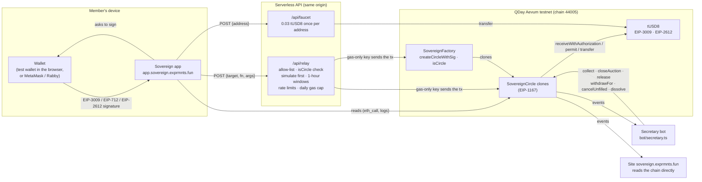
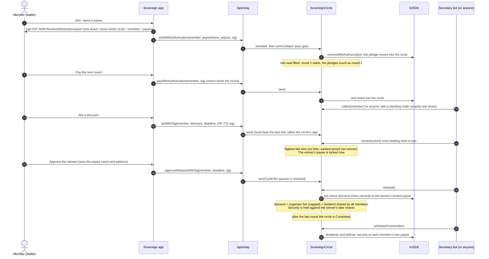

# Sovereign

**A savings circle where members bid for the pot, in tUSD8 on QDay Aevum. Members never need gas, the pot can
only go to a named and locked payee, and nobody (not even the organiser) can run away with the money.**

> Built for the QDay **Aevum Builder Challenge #1** (DoraHacks), Crowdfunding track.
> Submission deadline: **11 Dec 2026, 16:00 HKT (08:00 UTC)**. Status: **live on Aevum testnet**: contracts verified, web app + gasless
> relayer at https://app.sovereign.exprmnts.fun, secretary bot running, 63 transactions of on-chain proof in [`docs/PROOF.md`](docs/PROOF.md).

A savings circle is how families and small shops across Asia, Africa and Latin America have saved and borrowed for
generations: everyone pays the same amount each round, and each round one member takes the whole pot. In the bidding
kind (a hui in Hong Kong and Taiwan, a chit fund in India) whoever needs it soonest bids the biggest discount, and the discount is shared by everyone as a
dividend. Sovereign keeps the members sovereign over their own money: no organiser, relayer or bot can take it.

The weak point has always been trust: the organiser holds the cash, a member stops paying after taking the pot,
or the pot goes to the wrong person. Sovereign moves the rules into a contract on Aevum.

**Try it: https://sovereign.exprmnts.fun** (no wallet needed: open a practice circle with two friendly bots and play full
rounds in a few minutes) · app: https://app.sovereign.exprmnts.fun · proof: https://sovereign.exprmnts.fun/proof

**Contents:** [Safety](#what-makes-it-safe) · [Why this is crowdfunding](#why-this-is-crowdfunding) · [Addresses](#live-on-aevum-testnet-chain-44005) ·
[Architecture](#architecture) · [One round, step by step](#one-round-step-by-step) · [API](#api) · [Environment variables](#environment-variables) ·
[Reproduce it](#reproduce-it-step-by-step) · [Known constraints](#known-constraints) · [Roadmap to mainnet](#roadmap-to-mainnet) · [Layout](#layout)

## What makes it safe
| Risk | What the contract does |
|---|---|
| The organiser runs off with the pot | There is no owner or admin key. The organiser only gets a fee, capped at 5% of the pot and taken from discounts only. |
| A winner stops paying | Part of each winner's pot (half by default, never more than they still owe) is held as security and pays their later shares while it lasts ([on chain](docs/PROOF.md#c-a-past-winner-stops-paying-held-security-pays-the-share)). |
| A stolen key redirects the pot | Every pot goes to a **named, locked payee**. A change waits a delay the circle sets (the app offers 5 minutes to 48 hours), every member sees it, and it can be cancelled with one signature ([on chain](docs/PROOF.md#1-a-whole-circle-live-2026-11-22-2116-utc), steps 14 and 15). |
| The circle never fills | Joining is a **pledge**. If the circle is not full by its deadline, every pledge is refunded ([on chain](docs/PROOF.md#a-circle-does-not-fill-pledges-refunded)). |
| A round stalls | Anyone can dissolve the circle; what is left goes back pro rata ([on chain](docs/PROOF.md#b-round-stalls-circle-dissolved-refunds-pro-rata)). |
| Forgetting to pay | A **standing order**: exactly one share per round, at most N rounds, expires, revocable at any time ([revoked on chain](docs/PROOF.md#d-standing-order-revoked-it-can-no-longer-collect)). |
| Members have no gas token | Every action is a **signature** (EIP-3009, EIP-712, EIP-2612); a relayer submits it. |

Full rules: [`docs/RULES.md`](docs/RULES.md).

## Why this is crowdfunding
A savings circle is crowdfunding that takes turns. **Every member crowdfunds every other member's pot, round by round:**
in each round the whole group funds one member's goal (a shop's stock, school fees, a deposit), and over the life of the
circle everyone is both a backer and a recipient exactly once.

Joining is a **pledge** under the classic all-or-nothing crowdfunding rule. Your first share is paid in when you join, and
if the circle does not reach its goal (all of its members) by the deadline, anyone can cancel it and **every pledge is
refunded in full**. This is on chain: in [PROOF.md section A](docs/PROOF.md#a-circle-does-not-fill-pledges-refunded) a
3-member circle closed with 1 member, was cancelled, and Ah Ming got his whole 0.05 tUSD8 back.

## Live on Aevum testnet (chain 44005)
| | |
|---|---|
| SovereignFactory (verified) | [`0xc81C215C64A5145067f56DD461Cb058f05A7c898`](https://explorer-test.qday.info/address/0xc81C215C64A5145067f56DD461Cb058f05A7c898) |
| SovereignCircle implementation (verified) | [`0x5a2F6Aa2659F196E8AbfA42FF85E8d11F4c83922`](https://explorer-test.qday.info/address/0x5a2F6Aa2659F196E8AbfA42FF85E8d11F4c83922) |
| tUSD8 (QDay's test dollar, 6 decimals) | [`0x456569838f1d43009A91ebA4263147Afd7233483`](https://explorer-test.qday.info/address/0x456569838f1d43009A91ebA4263147Afd7233483) |
| RPC · explorer | `https://rpc-test.qday.info` · https://explorer-test.qday.info |
| A full circle (29 transactions) and the safety paths (34) | [`docs/PROOF.md`](docs/PROOF.md) |

The same addresses, with deploy blocks and transactions, are in [`deployments/aevum.json`](deployments/aevum.json).

## Architecture
Members only ever **sign**. The app turns each action into a signed message, the relayer checks it and pays the gas,
and the contracts enforce every rule. The secretary bot is a convenience: everything it does, anyone may do.



Why nobody in the middle can take money: the relayer can only call the functions on its allow-list, only on the factory
or on circles `factory.isCircle()` confirms, and every amount, round, payee and discount is inside the member's signature.
The functions anyone may call (`closeAuction`, `release`, `collect`, `withdrawFor`, ...) only move money along paths the
contract already fixed: into the circle, or to a member's own locked payee.

## One round, step by step
Three members, Ah Ming, Kitty and Wing. Joining fills the circle and starts round 1 (the pledges are round 1's payments).



## API
The relayer and faucet are documented in [`docs/API.md`](docs/API.md), with request and response shapes, error codes and a
curl example for each endpoint. A short taste:

```bash
curl -s https://app.sovereign.exprmnts.fun/api/health
# {"ok":true,"block":"…","factory":"0xc81C…c898","relayer":"0x…","relayerGas":"<tQDAY>","faucet":"0x…","faucetUsd8":"<tUSD8>"}

curl -s -X POST https://app.sovereign.exprmnts.fun/api/relay -H 'content-type: application/json' \
  -d '{"target":"0xa6E05d1b8464ac07A701a4AE899E26D68B6F6831","fn":"closeAuction","args":[]}'
# {"error":"That action is not possible at this stage of the circle.","code":"WOULD_REVERT"}   (refused in simulation, no gas spent)
```

Signing helpers shared by the app, the relayer, the bot and the scripts: [`scripts/lib/sign.ts`](scripts/lib/sign.ts).

## Environment variables
Nothing reads a `.env` file automatically; set these in the shell, or in Vercel's project settings for the API.
A commented template is in [`.env.example`](.env.example).

| Variable | Used by | What it is | Default |
|---|---|---|---|
| `RELAYER_PRIVATE_KEY` | `api/relay.ts`, `api/health.ts` | The relayer's key. Holds only tQDAY (gas). Anvil's public keys 0 to 2 are refused. | none (relay answers `503 NOT_CONFIGURED`) |
| `FAUCET_PRIVATE_KEY` | `api/faucet.ts`, `api/health.ts` | Key that holds the tUSD8 the starter faucet sends (0.03 per address). | none (faucet answers `503 NOT_CONFIGURED`) |
| `RELAY_DAILY_GAS_CAP_WEI` | `api/relay.ts` | Most gas the relayer spends per UTC day, in wei. Counted in memory, per instance. | `50000000000000000` (0.05 tQDAY) |
| `TRUSTED_IP_HEADER` | `api/lib/shared.ts` | Header with the caller's IP for rate limits; `x-forwarded-for` is the fallback. | `x-vercel-forwarded-for` |
| `AEVUM_RPC` | `scripts/lib/aevum.ts` (so the API, bot and scripts), `Makefile` | Aevum RPC URL. Point it at a local anvil fork to run everything locally. The shipped browser bundles always use the public RPC. | `https://rpc-test.qday.info` |
| `SOVEREIGN_FACTORY` | `scripts/lib/aevum.ts` | Use a factory you deployed yourself instead of the one in `deployments/aevum.json`. | the deployed factory |
| `SOVEREIGN_KEYS` | `bot/secretary.ts`, `scripts/*.ts` | JSON file of throwaway test keys: `ops`, `relayer`, `secretary`, `ahming`, `kitty`, `wing`, `siumei`, each `{address, privateKey}`. | `~/.config/sovereign/accounts.json` |
| `TICK_MS` | `bot/secretary.ts` | How often the bot checks every circle, in ms. | `8000` |
| `PROOF_DIR` | `scripts/demo-circle.ts`, `scripts/edge-proofs.ts` | Where the proof JSON is written. Use another folder on a fork. | `docs/proof` |
| `RELAY_URL` | `scripts/edge-proofs.ts` | The relayer step E asks (a refused, simulated call). | `https://app.sovereign.exprmnts.fun/api/relay` |
| `PORT` | `scripts/serve-app.ts` | Port of the local app server. | `3000` |
| `ACCOUNT` | `Makefile` (`make deploy-aevum`) | Foundry keystore name to deploy with. | none |
| `TOKEN`, `IMPLEMENTATION` | `script/Deploy.s.sol` | Token for the factory, and an existing implementation to reuse. | tUSD8, deploy a new one |

## Reproduce it, step by step
Needs [Foundry](https://book.getfoundry.sh) (forge and anvil; tested with 1.8) and Node 22+.

**1. Build and test** (no keys, no network except the fork test's reads):
```bash
git clone --recursive https://github.com/nikhil-pn/sovereign && cd sovereign
npm install
make build       # compile + QDay's Shanghai opcode check (Aevum has no Cancun opcodes)
make test        # 49 unit, fuzz and invariant tests
make test-fork   # 1 fork test: a whole gasless circle against the REAL tUSD8 on a local fork of Aevum
```

**2. Start a local fork of Aevum** (terminal 1). `--block-time 1` mines a block every second like Aevum does; without it,
time stands still between transactions and the bot and the scripts wait forever.
```bash
anvil --fork-url https://rpc-test.qday.info --hardfork shanghai --block-time 1
```

**3. Fresh keys with gas and tUSD8, on the fork only** (terminal 2; everything below runs in this terminal unless noted):
```bash
export AEVUM_RPC=http://127.0.0.1:8545 SOVEREIGN_KEYS=.fork/accounts.json PROOF_DIR=.fork/proof
npx tsx scripts/fork-setup.ts        # refuses any RPC that is not localhost
export RELAYER_PRIVATE_KEY=$(node -p 'require("./.fork/accounts.json").relayer.privateKey')
export FAUCET_PRIVATE_KEY=$(node -p 'require("./.fork/accounts.json").ops.privateKey')
```

**4. Deploy** (optional). The fork already contains the verified factory from `deployments/aevum.json`, and everything
uses it by default. To deploy your own copy and use it instead:
```bash
KEY=$(node -p 'require("./.fork/accounts.json").ops.privateKey')
IMPL=$(forge create src/SovereignCircle.sol:SovereignCircle --rpc-url $AEVUM_RPC --private-key $KEY --legacy --broadcast | awk '/Deployed to:/{print $3}')
forge create src/SovereignFactory.sol:SovereignFactory --rpc-url $AEVUM_RPC --private-key $KEY --legacy --broadcast \
  --constructor-args 0x456569838f1d43009A91ebA4263147Afd7233483 $IMPL     # prints "Deployed to: <factory>"
export SOVEREIGN_FACTORY=<factory>
```
(`make deploy-aevum` runs `script/Deploy.s.sol` against the real testnet; on a fork prefer `forge create` as above,
because `forge script` would record the fork run in `broadcast/`.)

**5. Check the relayer's rails** (13 checks, in-process, against the fork):
```bash
npx tsx scripts/test-relay.ts
```

**6. Run the app and its API locally** (terminal 3, same exports as step 3):
```bash
npx tsx scripts/serve-app.ts         # http://127.0.0.1:3000  (live mode: http://127.0.0.1:3000/?mode=live)
curl -s http://127.0.0.1:3000/api/health
```
Use "Make a test wallet" in the app (a browser wallet would add the public Aevum RPC, not your fork). The faucet sends the
new wallet 0.03 tUSD8; then open a circle and invite a second browser profile, or open a practice circle in demo mode
and run the bot (step 8) to play the two bot members.

**7. A whole circle and the safety paths, on chain** (each writes its proof JSON to `$PROOF_DIR`; about 6 and 10 minutes,
because the rounds really run):
```bash
npx tsx scripts/demo-circle.ts                                            # the 29-transaction circle in PROOF.md section 1
RELAY_URL=http://127.0.0.1:3000/api/relay npx tsx scripts/edge-proofs.ts  # the 34 safety-path transactions in section 2
```
Run these **without** the bot: they close rounds and pay out themselves, and the bot would race them.

**8. The secretary bot** (keeps every circle on the factory moving; plays Ah Ming and Kitty in practice circles):
```bash
npx tsx bot/secretary.ts
```
On the real testnet it runs as a systemd user unit: [`bot/sovereign-secretary.service`](bot/sovereign-secretary.service).

**Rebuilding the front ends:** `bash scripts/build-site.sh` copies the proof JSON into `web/data/` for the site;
`bash scripts/build-app.sh` bundles `web-src/` into `web-app/` and `api/` into `web-app/api/` for Vercel.

## Known constraints
Stated plainly, so nobody has to find them:
- **Testnet only.** tUSD8 and tQDAY have no value. Nothing here has been audited.
- **The relayer is a single service.** It cannot move anyone's money, but it could stop relaying (or be down). Members can
  always call the contract directly (`join`, `pay`, `bid`, `approveRelease`, `leave`, ...) and pay their own gas; the app
  does not offer that fallback yet.
- **Rate limits and the daily gas cap live in memory, per serverless instance.** Fine for one instance; several instances
  each keep their own counters.
- **The secretary bot runs on one machine.** If it stops, circles still work: anyone (any member, the app, a script) can
  call `closeAuction`, `release`, `collect`, `withdrawFor`, `cancelUnfilled` and `dissolve`.
- **Bids are open.** Everyone sees the best bid, and a last-second bid can win; there is no auction extension yet.
- **Held security is half of a winner's pot by default** (a circle can choose 0 to 100%), never more than they still owe.
  It may not cover every later share of a winner who stops paying early in a long circle; dissolve then shares the loss pro rata.
- **Payee names are self-declared**, not KYC. The lock stops a quiet redirect; it does not prove who someone is.
- **EIP-712 actions use one nonce per member per circle**, so two signatures prepared at the same time conflict and the second must be signed again.
- **No audit.** The tests (49 + a fork test), invariants and the on-chain runs are the evidence so far.

## Roadmap to mainnet
- **QDay mainnet (planned Q1 2027) with USD8**: the same contracts, pointed at USD8 instead of tUSD8.
- **QDay's paymaster and session-key smart accounts**, once officially supported, in place of our own relayer; the contract
  already accepts EIP-1271 smart-account signatures.
- **ERC-8004 identity for the secretary agent** when the registry opens, so members can see which agent tends their circle.
- **A shared store for rate limits and the gas cap**, so they hold across serverless instances.
- **An own-gas fallback in the app**: if the relayer is down, members send the same action directly.
- **An auction extension** against last-second sniping (a late bid extends bidding by a short window).
- **Per-action nonces**, so a member can prepare several signatures at once.
- **An external audit** before real money.
- **Distribution and revenue:** savings circles already live in community groups (families, market traders, migrant
  workers' groups, chat groups), so the plan is to grow through those groups and their organisers. The organiser fee is
  the revenue line: set per circle, taken only from discounts, and capped by the contract at 5% of the pot.

## Layout
```
src/SovereignCircle.sol   one circle: pledges, rounds, auction, payee lock, standing orders, release, dissolve
src/SovereignFactory.sol  opens circles as EIP-1167 clones of one implementation; isCircle() for the relayer
test/                     49 unit, fuzz and invariant tests; the fork test on real tUSD8 (test/fork)
script/Deploy.s.sol       deploys the implementation and the factory
docs/                     RULES.md (the rules in plain words), API.md (relayer + faucet), PROOF.md (on-chain proof)
api/                      the gasless relayer, the starter faucet and a health check (Vercel functions)
bot/secretary.ts          the secretary bot (+ its systemd unit)
scripts/                  demo-circle, edge-proofs, test-relay, fork-setup, serve-app, build-site, build-app
web/                      the site (sovereign.exprmnts.fun): plain HTML, CSS and JS that read the chain directly
web-src/                  the app's TypeScript, built into web-app/ (app.sovereign.exprmnts.fun) by scripts/build-app.sh
tools/check-shanghai.mjs  opcode check from the Aevum Starter Kit
```

## Credits
Built on ideas and tooling from the [Aevum Starter Kit](https://github.com/qday-io/aevum-starter-kit) (MIT, PQA Labs).
Third-party code and licenses: [`NOTICE.md`](NOTICE.md). How AI was used: [`AI_USAGE.md`](AI_USAGE.md). License: MIT.
